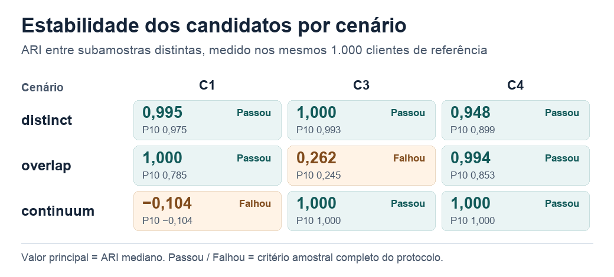
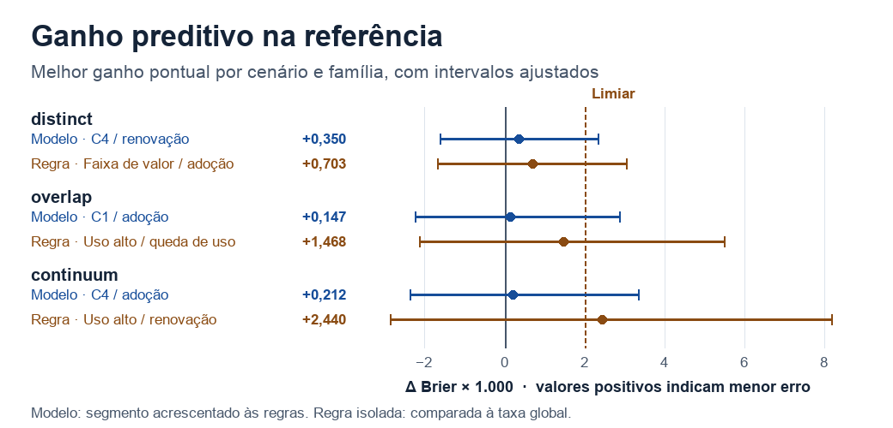
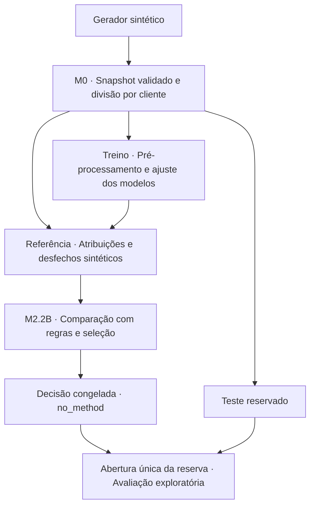

# Challenge TOTVS 2.0 — Segmentação B2B com dados sintéticos

## Origem acadêmica

A TOTVS propôs à FIAP um desafio acadêmico de Data Science sobre segmentação de clientes B2B. Representantes da TOTVS avaliaram as entregas acadêmicas. O trabalho foi desenvolvido em equipe. Minha contribuição se concentrou na preparação de dados, no treinamento e na geração de resultados de clusterização, além da coordenação da equipe.

**Challenge TOTVS 2.0** é a extensão experimental independente, de M0 a M2.2B. Ela usa clientes, contratos, telemetria e desfechos inteiramente sintéticos. A avaliação da TOTVS se refere às entregas acadêmicas originais. A extensão e sua decisão são de responsabilidade deste projeto de portfólio, sem homologação, patrocínio ou aprovação da TOTVS.

**Decisão do experimento: `no_method`.** Nenhum dos três modelos ou das seis regras atingiu o critério pré-registrado de promoção. A reserva foi aberta uma vez após o congelamento da decisão e seus resultados ficaram como exploratórios. Os resultados se limitam ao gerador e ao protocolo do estudo e não representam operações, clientes ou resultados comerciais reais da TOTVS.

[Relatório técnico — edição pública (PDF)](docs/reports/challenge_totvs_2_relatorio_tecnico_publico.pdf) · [Decisão registrada](m2.2b/results/validation-v1-recovered/confirmation.json)

## Resultados em destaque





- **C1 e C4 passaram em `distinct` e `overlap`.** C3 perdeu estabilidade em `overlap`. Em `continuum`, C3 e C4 dividiram de forma estável uma população gerada sem grupos discretos.
- **A estabilidade não se traduziu em ganho incremental suficiente.** Acrescentar o rótulo de cluster ao conjunto de regras gerou, no máximo, ganho de Brier de **0,000350** nos cenários usados para seleção.
- **As regras simples foram comparadores competitivos.** Em `overlap`, a regra de uso alto teve ganho pontual de **0,001468** frente à taxa global. Seu intervalo ajustado inclui zero. O gráfico indica o comparador usado por cada família.
- **Decisão `no_method`.** A promoção exigia ganho ≥ **0,002** e limite inferior ajustado acima de zero para o mesmo desfecho em `distinct` e `overlap`. Nenhum método atendeu ao critério.

Fontes dos gráficos: [manifesto dos ajustes](m2.2b/results/validation-v1-recovered/fit_manifest.json) e relatórios de referência [distinct](m2.2b/results/validation-v1-recovered/distinct-reference.json), [overlap](m2.2b/results/validation-v1-recovered/overlap-reference.json) e [continuum](m2.2b/results/validation-v1-recovered/continuum-reference.json).

## Dados e desenho experimental

`distinct_5k`, `overlap_5k` e `continuum_5k` têm 5.000 clientes sintéticos cada. Cada cenário usa uma divisão determinística de **3.000 para treino, 1.000 para referência e 1.000 para teste reservado**, por cliente. A chave do snapshot é `(dataset_id, cliente_id, data_corte)`. A base de 100 mil clientes foi usada separadamente para validar ingestão e integridade. [Contrato de dados](m0/CONTRATO_DADOS.md) · [Validação de volume](m0/VALIDACAO_LOCAL.md)

As transformações são ajustadas no treino. O snapshot distingue telemetria ausente de zero observado. A seleção usa desfechos da referência, com os indicadores futuros e os rótulos latentes fora da matriz de clusterização. Os três campos legados `*_90d` registram renovação, adoção e queda de uso na janela sintética de **92 dias**, de 01/10 a 31/12/2026. [Protocolo pré-registrado](m2.2b/PROTOCOLO.md)



## Evidências por etapa

| Etapa | O que foi verificado | Código e evidência |
|---|---|---|
| **M0 · Dados** | Contratos de esquema e chaves, snapshot determinístico, divisão disjunta e lista de features permitidas. | [Código](m0/snapshot.py) · [Testes](m0/tests/test_snapshot.py) |
| **M1 · Triagem** | 14 configurações de K-Means e GMM diagonal com `k=2…8` e seis ajustes adicionais. GMM diagonal com `k=2` liderou provisoriamente em P1. | [Código](m1/experiment.py) · [Resultados](m1/results/distinct-p1/report.json) |
| **M2.1 · Sensibilidade** | Em P1, K-Means com `k=2` isolou dois extremos do treino e deixou esse grupo vazio na referência. Duas preparações alternativas produziram partições estáveis por reamostragem, com **ARI de −0,103 entre elas**. O GMM P1 ficou abaixo do critério de estabilidade amostral. | [Código](m2.1/sensitivity.py) · [Matriz](m2.1/results/distinct/screen.csv) · [Relatório](m2.1/results/distinct/report.json) |
| **M2.2A · Controles** | Retirar só o indicador de cobertura preservou a partição inicial de C1; retirar toda a família de telemetria mudou a partição, com **ARI de 0,085**. C4 preservou zeros no corte de caudas. O GMM P2 reproduziu a regra binária de cobertura. | [Código](m2.2a/controls.py) · [Resultados](m2.2a/results/distinct-controls/report.json) |
| **M2.2B · Validação** | C1 e C4 passaram no critério de estabilidade em `distinct` e `overlap`. C3 passou em `distinct` e perdeu estabilidade em `overlap`. C3 e C4 também dividiram de forma estável o cenário `continuum`, gerado sem grupos discretos. | [Código](m2.2b/validation.py) · [Manifesto dos ajustes](m2.2b/results/validation-v1-recovered/fit_manifest.json) · [Decisão congelada](m2.2b/results/validation-v1-recovered/confirmation_freeze.json) |

A cópia pública mantém as etapas nos caminhos usados pelo código. Os manifestos e relatórios registram as execuções. A [proveniência da edição pública](docs/PROVENIENCIA.md) explica quais evidências estão disponíveis e quais ficaram no acervo.

## Como interpretar a decisão

Na referência, os modelos foram avaliados pelo **ganho de Brier fora do fold** ao acrescentar o segmento ao conjunto de regras simples. Cada regra isolada foi comparada à taxa global aprendida no treino do fold. A promoção exigia ganho de pelo menos **0,002** e limite inferior do intervalo ajustado acima de zero para o mesmo desfecho em `distinct` e `overlap`. Os modelos também precisavam passar no critério de estabilidade nos dois cenários. `continuum` foi usado como diagnóstico.

O maior ganho incremental de um cluster em `distinct` foi **+0,000350**, de C4 para renovação, com intervalo ajustado **[−0,001622; +0,002329]**. Em `overlap`, foi **+0,000147**, de C1 para adoção, com intervalo **[−0,002250; +0,002859]**. Esses máximos pertencem a candidatos e desfechos diferentes. Os intervalos na referência são condicionais às previsões já calculadas e não incorporam a variabilidade de reajuste das tabelas de risco. [Referência distinct](m2.2b/results/validation-v1-recovered/distinct-reference.json) · [Referência overlap](m2.2b/results/validation-v1-recovered/overlap-reference.json) · [Referência continuum](m2.2b/results/validation-v1-recovered/continuum-reference.json)

## Inspeção e reprodução local

Para explorar a execução concluída, comece pelo [pré-registro](m2.2b/results/validation-v1-recovered/preregistration.json), pelo [manifesto de ajustes](m2.2b/results/validation-v1-recovered/fit_manifest.json) e pelo [resultado da confirmação](m2.2b/results/validation-v1-recovered/confirmation.json). A execução consolidada está em `validation-v1-recovered`. O [marcador de abertura](m2.2b/TESTE_ABERTO.json) registra o consumo da reserva. A edição pública usa um caminho relativo e inclui o hash do registro original.

Os exemplos abaixo são opcionais. A partir da raiz, abra um shell POSIX com Python 3.12 e mantenha a estrutura de pastas. Use uma saída nova e fora da árvore de evidências. As dependências estão fixadas no [arquivo de requisitos do M2.2B](m2.2b/requirements.txt).

```sh
REPRO_DIR="$(mktemp -d)"
python3.12 -m venv "$REPRO_DIR/venv"
"$REPRO_DIR/venv/bin/python" -m pip install -r m2.2b/requirements.txt

# Gerar um novo snapshot a partir da amostra sintética.
"$REPRO_DIR/venv/bin/python" -B m0/snapshot.py \
  --dataset m0/samples/distinct_5k --out "$REPRO_DIR/snapshot" --seed 101

# Reproduzir os ajustes com atributos observados, em uma saída separada.
LOKY_MAX_CPU_COUNT=2 "$REPRO_DIR/venv/bin/python" -B m2.2b/validation.py fit \
  --out "$REPRO_DIR/fits"
```

A fase `fit` é um ajuste novo com atributos observados nos três cenários e avaliação estrutural na referência. Ela não abre a reserva nem reproduz a seleção histórica com desfechos. Os exemplos usam os fixtures observados incluídos e um endereço novo para a saída. O ambiente histórico foi Python 3.12.14 em macOS ARM64. A reprodução em outras plataformas depende da disponibilidade das dependências e não implica igualdade byte a byte dos arquivos regenerados.

A suíte integral histórica depende de dados reservados e de volume mantidos no acervo. **Não rode `validation.py confirm` nesta cópia.** A reserva foi consumida para este protocolo. Consulte as [instruções da etapa final](m2.2b/README.md) e o [inventário de arquivos da edição pública inicial](docs/ARQUIVOS_SHA256.txt).
